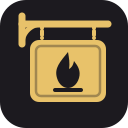
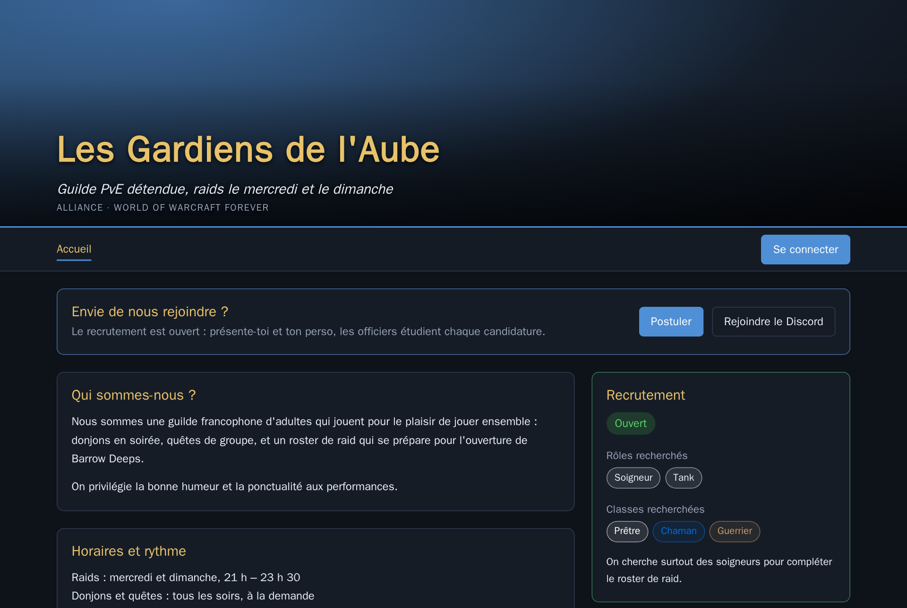
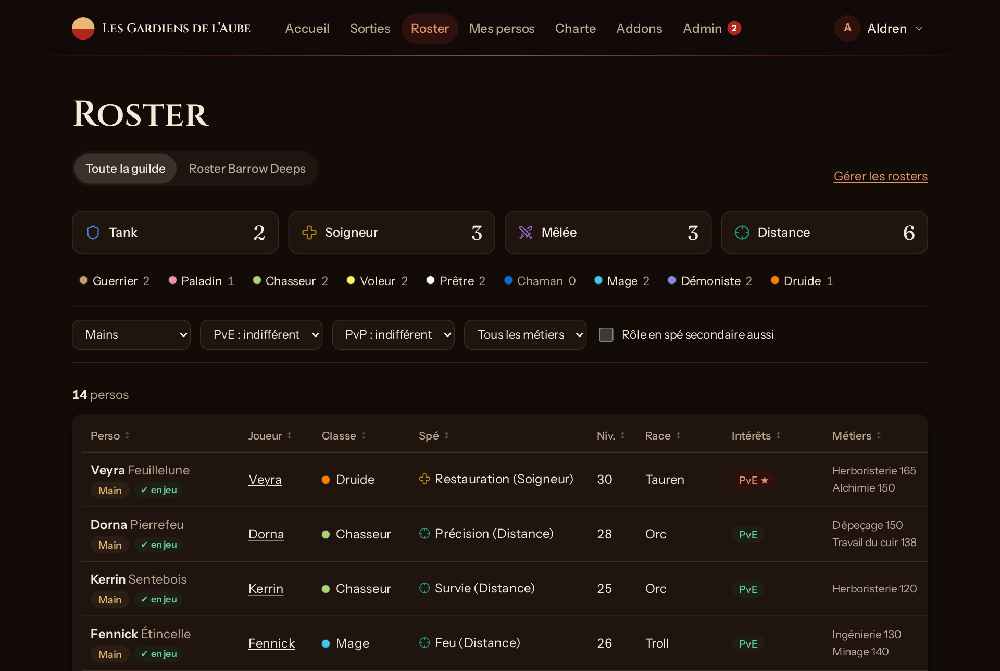
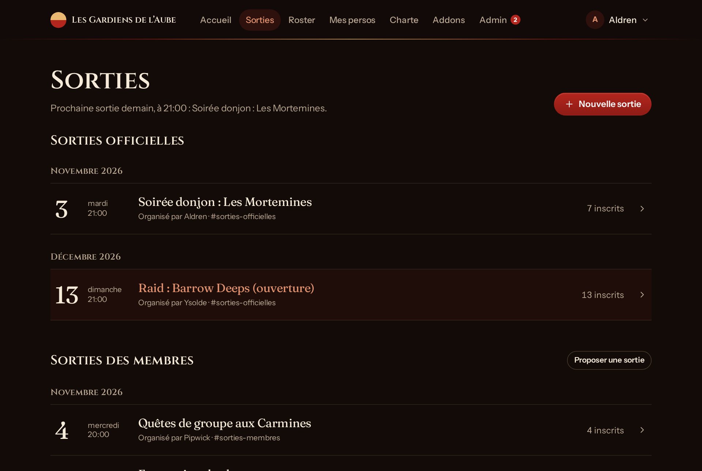
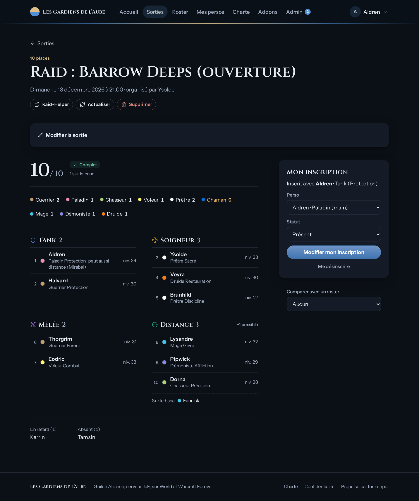
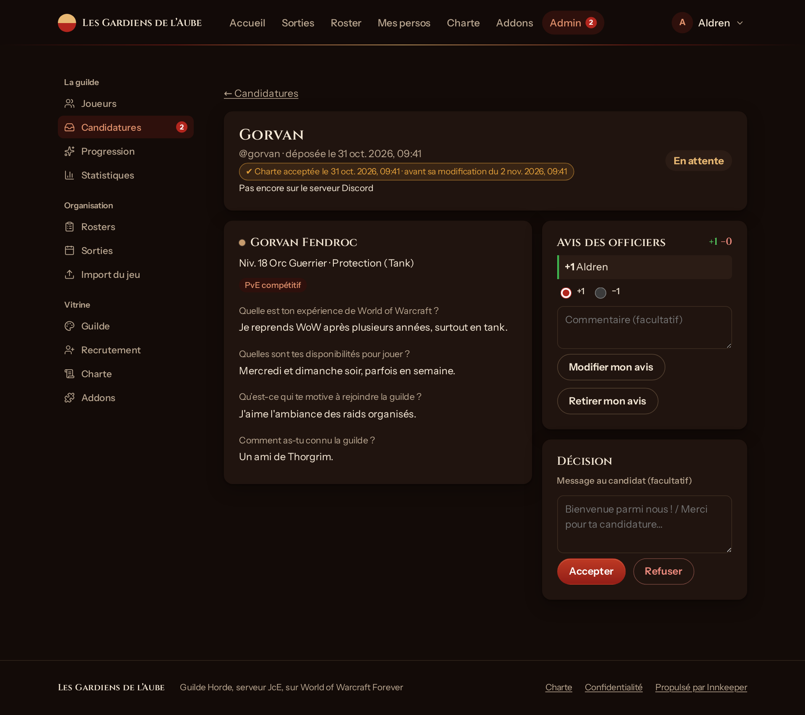
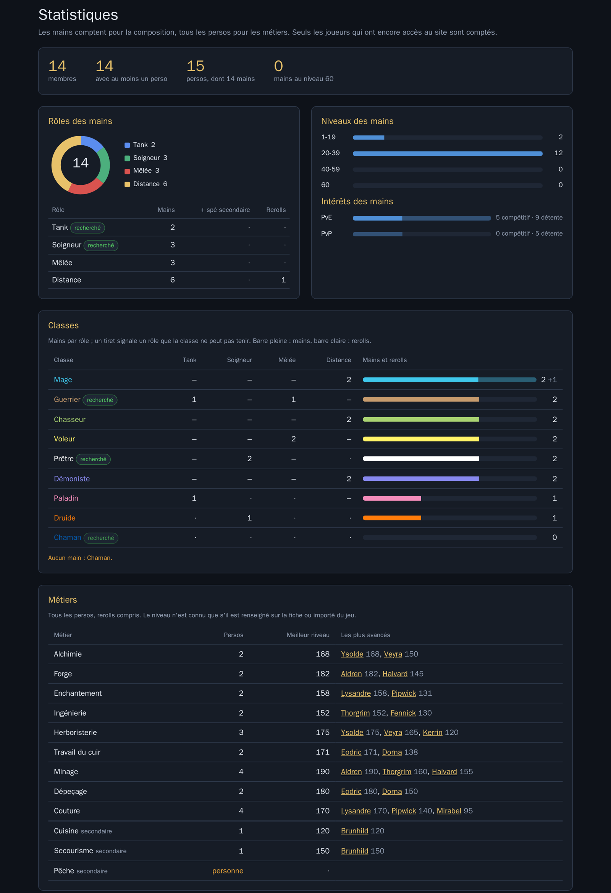
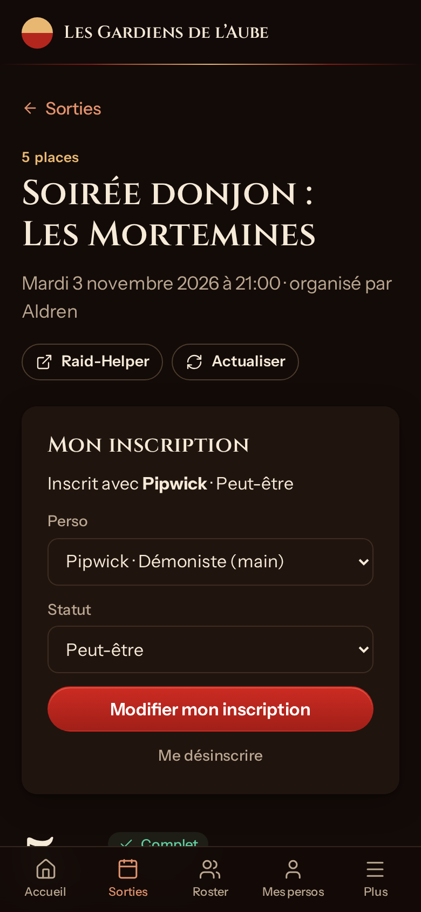

<p align="center">
  
</p>

<h1 align="center">Innkeeper</h1>

<p align="center"><em>Pose ta pierre de foyer : le point de ralliement de ta guilde.</em></p>

<p align="center">
  <a href="LICENSE">Licence AGPL v3</a> ·
  <a href="docs/GUIDE.md">Guide d'utilisation</a> ·
  <a href="CHANGELOG.md">Journal des modifications</a>
</p>

<p align="center">
  
</p>

**Innkeeper** est un portail de guilde auto-hébergeable pour **World of Warcraft: Forever**, construit autour de Discord et de Raid-Helper. Une instance correspond à une guilde (Alliance, Horde ou multi-faction, sur un serveur JcJ, JcE, JdR ou Hardcore). Les joueurs se connectent avec Discord ; leurs droits découlent de leurs rôles sur le serveur de la guilde.

- **Fiches de persos** tenues par chaque joueur : main et rerolls, double spécialisation, métiers avec niveau, intérêts PvE/PvP.
- **Roster** filtrable et triable, répartition par classe et par rôle, **rosters** composés par les officiers (équipe de raid, PvP…).
- **Sorties** pilotées dans [Raid-Helper](https://raid-helper.dev) : création depuis le site (officielles et proposées par les membres), médaillon par type (quêtes, donjon, raid, PvP, farm), inscription depuis le site, composition, comparaison avec un roster, banc.
- **Charte et règlement** rédigés dans l'admin, publiés pour tous et à accepter pour postuler.
- **Addons conseillés** par la guilde : indispensables, requis en raid, recommandés, confort, avec le public visé (classes, rôles) et les liens CurseForge et Wago.
- **Recrutement** : candidature en ligne, avis des officiers, entrée sur le serveur Discord et rôle d'arrivée posés par le bot, suivi des nouveaux membres.
- **Import des données du jeu** par un addon, à la main ou automatiquement avec l'application InnkeeperSync pour PC (registre de guilde, métiers, recettes, dernière connexion).
- **Statistiques pour les officiers** : composition par classe et par rôle face au recrutement, métiers et meilleurs artisans, niveaux, intérêts, activité, fiches à compléter.
- **Administration** sans éditer de fichiers : assistant d'installation, profil de guilde, rôles, journal des actions.
- **Aux couleurs de la guilde** : palette de fond selon la faction (bruns chauds pour la Horde, bleu nuit pour l'Alliance, anthracite pour une guilde multi-faction), couleur d'accent, logo, bannière et icônes de classe au choix (aucune image de Blizzard n'est fournie).

Le guide d'utilisation (membres et officiers) est dans [docs/GUIDE.md](docs/GUIDE.md).

### Aperçu

Captures prises sur une guilde de démonstration fictive.

| | |
|---|---|
|  |  |
| **Roster** : filtres, répartition, badge « en jeu » venu de l'addon. | **Sorties** : officielles et proposées par les membres, tirées de Raid-Helper. |
|  |  |
| **Une sortie** : composition par rôle et par classe, banc, inscription depuis le site. | **Une candidature** : réponses, avis des officiers, décision. |

<p align="center">
  <br>
  <em>Statistiques des officiers : les manques sautent aux yeux (classes sans main, métiers sans artisan, rôles recherchés).</em>
</p>

<p align="center">
  <br>
  <em>Sur téléphone</em>
</p>

---

## Sommaire

1. [Architecture](#architecture)
2. [Choix techniques](#choix-techniques)
3. [Installation](#installation)
4. [Configuration Discord](#configuration-discord)
5. [Raid-Helper et sorties](#raid-helper-et-sorties)
6. [Addon InnkeeperSync](#addon-innkeepersync)
7. [Sécurité et données personnelles](#sécurité-et-données-personnelles)
8. [Exploitation](#exploitation)
9. [Mode démo](#mode-démo)
10. [Développement](#développement)
11. [Limites connues](#limites-connues)
12. [Licence](#licence)

---

## Architecture

```
                      Navigateur des joueurs
                               │ HTTPS
                     ┌─────────▼──────────┐
                     │  Reverse proxy     │  (Traefik, Caddy, nginx…)
                     └─────────┬──────────┘
                               │ HTTP :3000
┌──────────────────────────────▼───────────────────────────────┐
│ Conteneur « site » (Node 22, SvelteKit + adapter-node)       │
│                                                              │
│  Pages et formulaires ── Auth.js (OAuth Discord, session JWT)│
│  Modules serveur ─────── Drizzle ORM ── SQLite (/data)       │
│     │            │                │                          │
└─────┼────────────┼────────────────┼──────────────────────────┘
      │            │                │
      ▼            ▼                ▼
 API Discord   API Raid-Helper   Fichier de l'addon (déposé
 (OAuth + bot   (lecture publique  par un officier, lu sans
  en REST)       + clé du serveur)  être exécuté)
```

### Pile

| Élément | Choix |
|---|---|
| Application | SvelteKit 2 (Svelte 5, runes), TypeScript, `adapter-node` |
| Base de données | SQLite (`better-sqlite3`) via Drizzle ORM, migrations versionnées dans `drizzle/` |
| Authentification | Auth.js (`@auth/sveltekit`), fournisseur Discord, session JWT |
| Validation | zod |
| Tests | Vitest |
| Livraison | Image Docker unique (amd64 et arm64), publiée par la CI GitHub sur GHCR |

### Organisation du code

```
src/
├── hooks.server.ts         assistant d'installation, Auth.js, session (joueur, candidat, admin local)
├── auth.ts                 configuration Auth.js, lue en base (Discord configurable sans redémarrage)
├── lib/
│   ├── game/forever.ts     données de jeu Forever (races, classes, spés, métiers, instances, Raid-Helper)
│   ├── activities.ts       types de sortie (donjon, raid, quêtes…) et réglages par défaut
│   ├── components/         composants partagés
│   └── server/             logique serveur
│       ├── db/schema.ts    schéma de la base
│       ├── settings.ts     réglages de l'instance (table settings)
│       ├── bot.ts          appels REST du bot Discord
│       ├── raidhelper.ts   API Raid-Helper
│       ├── outings.ts      sorties : modèles, règles, dates, liste
│       ├── signups.ts      inscriptions depuis le site
│       ├── recruitment.ts  candidatures, arrivée des recrues
│       ├── game-import.ts  import de l'export de l'addon
│       ├── stats.ts        chiffres publics de l'accueil, statistiques des officiers
│       └── …
└── routes/                 pages (fr) : /persos, /roster, /sorties, /admin/…
addon/InnkeeperSync/        addon d'export pour le jeu (Lua)
drizzle/                    migrations SQL
scripts/backup.mjs          sauvegarde à chaud de la base
```

### Deux niveaux de données

- **Données de jeu Forever** (`src/lib/game/forever.ts`) : races et factions, types de serveur, combinaisons race × classe, spés et rôles, métiers, donjons et raids, correspondance avec le modèle Raid-Helper `wowforever`. **Communes à toutes les instances**, versionnées dans le dépôt, mises à jour par le projet quand Blizzard change le jeu.
- **Configuration de la guilde** (table `settings`) : connexion Discord, rôles et permissions, profil, recrutement, Raid-Helper. **Propre à chaque instance**, modifiée depuis l'interface d'administration.

---

## Choix techniques

| Décision | Raison |
|---|---|
| **Une instance par guilde**, pas de multi-guilde | Simplicité, données isolées, chaque guilde maîtrise son hébergement. |
| **SQLite** | Un seul fichier à sauvegarder, aucune base à administrer ; largement suffisant pour une guilde. |
| **SvelteKit 2** (et non 3) | `@auth/sveltekit` 1.x ne supporte pas encore SvelteKit 3. |
| **Configuration en base**, `.env` réduit à `ORIGIN` | Une guilde s'installe sans éditer de fichiers ; Discord se reconfigure sans redémarrer. |
| **Connexion uniquement par Discord** (+ un compte admin local de secours) | Les guildes vivent déjà sur Discord ; les droits suivent les rôles du serveur. |
| **Bot en REST uniquement**, sans connexion permanente | Rien à maintenir en ligne ; le bot apparaît hors ligne, c'est normal. Le site l'appelle seulement quand il en a besoin. |
| **Raid-Helper reste la source des inscriptions** | Les joueurs l'utilisent déjà ; le site le pilote (création, inscription, modification) au lieu de le réimplémenter. |
| **Relecture après chaque écriture Raid-Helper** | Ses réponses ne sont pas fiables (200 avec un statut inattendu, 400 alors que la modification est faite) : le site vérifie l'état réel. |
| **Addon d'export plutôt que l'API Blizzard** | On ne sait pas si Forever sera exposé dans l'API publique, ni comment sans royaumes ; l'API Classic ne donne pas les métiers. |
| **Aucune donnée Blizzard livrée** (images d'instances) | Questions de droits : chaque guilde dépose ses propres images. |
| **Tests à chaque construction d'image** | Une image ne sort pas si un test échoue. |

---

## Installation

### Prérequis

- Docker (et Docker Compose).
- Un nom de domaine et un reverse proxy en HTTPS devant le conteneur.
- Un serveur Discord dont tu es administrateur (ou l'aide de son administrateur).

### Démarrage

1. Dans un dossier vide, récupère le `docker-compose.yml` et crée un fichier `.env` avec l'adresse publique du site, sans slash final :
   ```sh
   curl -O https://raw.githubusercontent.com/fmplaw/innkeeper/main/docker-compose.yml
   echo "ORIGIN=https://guilde.mondomaine.fr" > .env
   ```
   Le fichier utilise l'image publiée de la dernière version (`ghcr.io/fmplaw/innkeeper:X.Y.Z`, amd64 et arm64) : rien à construire. Pour partir des sources, clone le dépôt et remplace la ligne `image:` par `build: .`.
2. Lance le conteneur :
   ```sh
   docker compose up -d
   ```
3. Récupère le **code d'installation** dans les logs :
   ```sh
   docker compose logs site
   ```
4. Ouvre `<ORIGIN>/installation` et suis l'assistant :
   - **compte admin local** : il configure l'instance et reste disponible en secours si Discord ne répond plus. D'autres admins peuvent être ajoutés ensuite (Admin → Compte admin) : comptes locaux (mot de passe provisoire à changer à la première connexion) ou **admins Discord**, des joueurs déjà connectés qui ont alors les droits d'admin avec leur connexion Discord, le compte local restant l'accès de secours ;
   - **application Discord** : voir [Configuration Discord](#configuration-discord) ;
   - **profil de guilde** : nom, faction, type de serveur, logo, bannière, couleur, présentation, ambitions, horaires, recrutement.

Tout reste modifiable ensuite dans **Admin**. La base est dans le volume `data` ; les migrations s'appliquent au démarrage.

### Derrière un reverse proxy

- `ORIGIN` doit être l'adresse publique en `https://`, exactement celle tapée dans le navigateur.
- `ADDRESS_HEADER=X-Forwarded-For` et `XFF_DEPTH=1` permettent à la limite de tentatives de connexion admin de voir la vraie adresse des visiteurs.
- Traefik sur le même hôte Docker : `docker-compose.traefik.yml` le configure par labels (voir `.env.example`).
- L'envoi d'images (bannière, images de sorties) demande des requêtes jusqu'à 6 Mo : l'image fixe `BODY_SIZE_LIMIT=6M`, vérifie que ton proxy l'accepte.
- **Box sans « hairpin NAT »** (fréquent en auto-hébergement) : depuis ton réseau local, le domaine public peut ne pas répondre. Ajoute une réécriture DNS locale (AdGuard, Pi-hole…) vers l'adresse du proxy, et un `extra_hosts` pour les conteneurs qui doivent joindre le site (supervision…).

### Adresse IP dynamique

Si ta connexion n'a pas d'IP fixe, utilise un DNS dynamique (DynHost chez OVH, etc.) mis à jour par un client comme ddclient. Évite un CNAME vers le nom fourni par ton opérateur s'il contient ton nom : il est visible par tous.

### Premier lancement d'un domaine neuf

Un domaine tout juste créé dont la page principale mène à une connexion Discord ressemble, pour les filtres automatiques, aux arnaques au vol de compte Discord. Google Safe Browsing peut alors afficher « Site dangereux ». Si c'est le cas : vérifie le domaine dans [Google Search Console](https://search.google.com/search-console), puis demande un examen (Sécurité → Problèmes de sécurité) en expliquant le site. La page `/confidentialite` sert d'appui. Attends la levée de l'avertissement avant d'annoncer l'adresse.

---

## Configuration Discord

### 1. Application OAuth

Sur le [portail développeur Discord](https://discord.com/developers/applications), crée une application.

- **Nom** : celui du site, par exemple « Portail de <guilde> » (32 caractères au plus). Les joueurs le lisent sur l'écran d'autorisation (« … veut accéder à ton compte ») ; le seul nom de la guilde laisse croire qu'on autorise la guilde, et le rôle géré du bot prendrait ce nom sur le serveur.
- **Icône** : le logo de la guilde, affiché sur l'écran d'autorisation. **Description** : une phrase et l'adresse du site, visibles sur le profil du bot.

- **OAuth2 → Redirects** : déclare exactement ces deux adresses (l'assistant les affiche) :
  ```
  <ORIGIN>/auth/callback/discord      connexion des joueurs
  <ORIGIN>/candidature/rejoindre      entrée des recrues sur le serveur
  ```
- Copie l'**identifiant du client** et la **clé secrète** dans l'assistant (ou Admin → Connexion Discord).
- Scopes demandés aux joueurs : `identify` et `guilds.members.read` (identifiant, pseudo, avatar, rôles sur le serveur de la guilde). Une recrue acceptée accorde en plus `guilds.join` une seule fois, pour que le bot la fasse entrer sur le serveur.

### 2. Bot

Le bot est nécessaire au recrutement et aux sorties. Il ne garde aucune connexion ouverte.

1. Onglet **Bot** du portail : **Reset Token**, puis colle le jeton dans Admin → Connexion Discord. Donne au bot un **nom d'utilisateur** distinct de la guilde : c'est lui qu'on voit dans la liste des membres.
2. Clique sur **« Inviter le bot sur le serveur »** dans la même page. Le lien demande ces permissions, et rien d'autre :

   | Permission | Usage |
   |---|---|
   | Créer une invitation | invitation de secours pour une recrue |
   | Voir les salons | annonces, repérage des sorties |
   | Envoyer des messages, Intégrer des liens | annonces des candidatures aux officiers |
   | Lire l'historique des messages | repérer les sorties Raid-Helper (identifiants des messages uniquement) |
   | Gérer les rôles | donner le rôle d'arrivée aux recrues |

3. Dans **Paramètres du serveur → Rôles**, place le rôle du bot **au-dessus du rôle d'arrivée** des recrues : un bot ne peut attribuer que des rôles placés sous le sien. Ce rôle géré prend le nom de l'application à l'invitation : renomme-le comme le bot pour ne pas le confondre avec un rang.
4. Dans un **salon privé** (salon des officiers, salons de sorties…), ajoute explicitement le rôle du bot aux permissions du salon : un refus posé sur `@everyone` s'applique aussi aux bots qui ne sont pas autorisés nommément.

Ce que fait le bot :

- synchroniser les vrais noms des rôles (Admin → Rôles Discord) ;
- annoncer les candidatures dans le salon des officiers ;
- faire entrer une recrue acceptée sur le serveur, rôle d'arrivée compris, puis lui envoyer la décision en message privé ;
- lister les membres du serveur sans compte sur le site (Admin → Joueurs) ;
- repérer les sorties Raid-Helper dans les salons quand aucune clé API n'est configurée.

### 3. Rôles et accès

Admin → **Rôles Discord** (réservé aux **admins de l'instance** : ces réglages décident qui est officier et qui entre sur le site) :

- chaque rôle reçoit une permission : **Officier**, **Membre** ou **Aucune** (invités extérieurs, par exemple) ;
- **mode d'accès** : tout membre du serveur, ou seulement les rôles désignés (conseillé dès que le serveur accueille des personnes extérieures à la guilde).

Un compte Discord connecté qui n'a pas accès devient **candidat** : il ne voit que l'accueil et sa candidature.

### 4. Recrutement

Admin → **Recrutement** : rôle d'arrivée, salon des annonces aux officiers et rôle à mentionner, salon des invitations de secours, délai avant de repostuler après un refus, délai de revue des nouveaux membres, questions posées aux candidats.

---

## Raid-Helper et sorties

### Lecture seule (sans configuration)

Les événements Raid-Helper du serveur sont lisibles sans clé : composition par rôle et par classe, comparaison avec un roster, banc. Le bot repère les sorties dans les salons qu'il voit.

### Clé API (création, inscription, modification)

1. Un administrateur du serveur tape `/apikey` dans Discord : Raid-Helper répond en privé. Ne colle jamais cette clé dans un salon.
2. Admin → **Sorties** (connecté en admin de l'instance) : colle la clé, elle est vérifiée avant d'être enregistrée.
3. Choisis le **salon des sorties officielles** et le **salon des sorties des membres**.

### Salons de sorties conseillés

Des salons **en lecture seule** où seul Raid-Helper écrit restent lisibles (les inscriptions passent par les boutons) et aident le site à retrouver les sorties. Le plus simple : régler une **catégorie** puis synchroniser ses salons.

| Ligne | Permissions |
|---|---|
| `@everyone` | Voir le salon ✅, Lire l'historique ✅, Ajouter des réactions ✅, Utiliser des émojis externes ✅ ; Envoyer des messages ❌, fils ❌, Utiliser les commandes de l'application ❌ |
| Raid-Helper | Voir ✅, Envoyer des messages ✅, Intégrer des liens ✅, Joindre des fichiers ✅, Ajouter des réactions ✅, **Utiliser des émojis externes ✅**, Gérer les messages ✅, Lire l'historique ✅, fils ✅, Mentionner @everyone ✅ ; **aucun ❌** |
| Bot du site | Voir le salon ✅, Lire l'historique ✅ |

> Un refus posé sur `@everyone` s'applique aussi aux bots, sauf autorisation explicite sur leur ligne. Sans « Utiliser des émojis externes », Raid-Helper refuse de créer une sortie.

### Événements Discord

Pour que les sorties **officielles** apparaissent aussi dans la liste des événements du serveur (avec rappels), donne la permission **Gérer les événements** au rôle Raid-Helper, puis coche la case correspondante dans Admin → Sorties. Les sorties des membres n'en créent jamais.

### Règles des sorties

- **Officielles** : créées par les officiers, salon officiel, modèles réutilisables, chef de raid au choix, événement Discord si activé.
- **Membres** : proposées par tout membre (pas de raid), salon dédié, le créateur en est l'organisateur et peut la modifier ou la supprimer ; trois sorties à venir au plus par joueur.
- Places, durée et image sont fixées selon le type de sortie et l'instance ; le titre est toujours envoyé sans police décorative (celle de Raid-Helper supprime les accents).
- Images d'instances : Admin → Sorties → Images des sorties (aucune image de Blizzard n'est fournie).
- Icônes de classe : Admin → Guilde → Icônes de classe, affichées à côté de chaque perso (sans icône, un blason à la couleur de la classe).

---

## Addon InnkeeperSync

Le client de WoW Forever est un client de type Retail (interface `16001`) avec un contenu Classic : l'addon utilise l'API moderne.

- **Téléchargement** : sur CurseForge et Wago Addons (« Innkeeper Sync », installation et mises à jour par leurs applications), ou `<ORIGIN>/addon/InnkeeperSync.zip`, à décompresser dans `Interface/AddOns`.
- **Fichiers TOC** : `InnkeeperSync.toc` et `InnkeeperSync_Camelot.toc` (type de jeu de Forever), identiques (test `src/lib/addon.test.ts`), interface `16001`.
- **En jeu** : `/innkeeper` (ou `/ik`), puis `/reload` (ou déconnexion) pour que le jeu écrive le fichier. Ouvrir la fenêtre d'un métier exporte ses recettes.
- **Fichier à déposer** : `WTF/Account/<COMPTE>/SavedVariables/InnkeeperSync.lua`, dans Admin → Import du jeu.

| Donnée | Source dans le jeu |
|---|---|
| Registre de guilde : niveau, classe, rang, dernière connexion | `GetGuildRosterInfo`, `GetGuildRosterLastOnline` |
| Métiers de toute la guilde, avec niveau | onglet Métiers de guilde (`GetGuildTradeSkillInfo`) |
| Métiers du perso connecté | `GetProfessions`, `GetProfessionInfo` |
| Recettes connues | `C_TradeSkillUI` |

L'addon n'envoie rien sur Internet (c'est l'application ci-dessous qui s'en charge, si le joueur l'installe). Le site lit le fichier **sans l'exécuter** (analyseur dédié au format des SavedVariables), relie les persos par leur nom (Forever n'a pas de royaumes) et les métiers par leur identifiant de compétence, indépendant de la langue. Un aperçu liste les changements, les membres sans fiche et les fiches introuvables en jeu avant toute application.

### Publication de l'addon (CurseForge, Wago, WoWInterface)

L'addon a ses propres versions (`## Version` du TOC, journal `addon/InnkeeperSync/CHANGELOG.md`) et ses propres tags : `InnkeeperSync-v1.2.0`, ou `InnkeeperSync-v1.2.0-beta1` pour une bêta. Un tag déclenche `.github/workflows/addon.yml`, qui vérifie que le tag correspond au TOC, copie l'addon dans un dépôt git temporaire (le BigWigs Packager veut l'addon à la racine) et le publie avec le Packager, qui reconnaît Forever (« Camelot », version de jeu 1.60.x).

- **Variables du dépôt** (identifiants des projets ; une plateforme sans identifiant est ignorée) : `CURSEFORGE_PROJECT_ID`, `WAGO_PROJECT_ID`, `WOWI_PROJECT_ID`.
- **Secrets** : `CF_API_TOKEN`, `WAGO_API_TOKEN`, `WOWI_API_TOKEN`.
- **Pas de jeton GitHub** donné au Packager : une release GitHub de l'addon deviendrait la plus récente du dépôt et casserait le lien de téléchargement de l'application et ses mises à jour (`releases/latest`).

### Application InnkeeperSync (synchronisation automatique)

Un addon WoW n'a aucun accès au réseau, et le jeu n'écrit son fichier qu'à la déconnexion ou au `/reload`. L'application `companion/` fait le lien : elle surveille `WTF/Account/*/SavedVariables/InnkeeperSync.lua` (à la racine du jeu ou dans un sous-dossier de version) et envoie le fichier au site dès qu'il change. Elle vit près de l'horloge, démarre avec Windows et se met à jour toute seule.

- **Technique** : [Tauri 2](https://tauri.app) (installateur d'environ 5 Mo, s'appuie sur WebView2, présent dans Windows 10 et 11). Toute la logique est en TypeScript : `companion/src/core` (recherche des fichiers, détection des écritures, envois, sans dépendance au système, testé avec le reste du projet) et `companion/src/app` (fenêtre et branchement sur les modules Tauri). `companion/src-tauri` n'est qu'une coquille Rust qui active ces modules (fichiers en lecture seule, HTTP, notifications, démarrage avec la session, liens `innkeeper://`, instance unique, mises à jour).
- **Connexion** : sur le site, Mes persos → Synchronisation automatique → « Connecter InnkeeperSync » crée une clé et ouvre `innkeeper://connect?site=…&token=…` ; l'application vérifie la clé et **demande confirmation** en affichant le site, pour qu'une autre page ne puisse pas la détourner. Coller une clé reste possible.
- **Clés** : 5 au plus par joueur, révocables ; seule leur empreinte SHA-256 est gardée.
- **Adresse** : `GET /api/sync` (vérifie la clé), `POST /api/sync` (fichier brut, 5 Mo au plus), en-tête `Authorization: Bearer iks_…`.
- **Droits** : clé d'officier = tout l'export, registre de guilde compris (référence « vu en jeu ») ; clé de membre = seulement ses persos. Les droits suivent les rôles Discord actuels du joueur.
- **Garde-fous** : un fichier identique au précédent n'est pas réimporté, deux envois d'un même compte à moins de 10 s sont refusés (l'application réessaie), un import qui modifie des persos est noté dans le journal (`game.sync`).
- **Publication** : à chaque tag `vX.Y.Z`, `.github/workflows/companion.yml` construit l'installateur Windows et l'AppImage Linux avec `tauri-action`, les attache à la release, publie `latest.json` (mises à jour) et une copie `InnkeeperSync-Setup.exe` (lien fixe du site). Les mises à jour sont signées : le secret `TAURI_SIGNING_PRIVATE_KEY` du dépôt contient la clé privée, la clé publique est dans `companion/src-tauri/tauri.conf.json`. Un fork doit générer sa propre paire (`npx tauri signer generate`) et changer `endpoints`. Pas encore de version Mac (signature Apple nécessaire).
- **Développement** : `cd companion && npm install && npx tauri dev`.

`addon/test/simulate.lua` exécute l'addon hors du jeu avec une fausse API WoW ; il produit le fichier utilisé par les tests de l'import.

---

## Sécurité et données personnelles

- **Aucun mot de passe Discord** ne transite par le site (OAuth officiel).
- **Admin local** : mot de passe haché (scrypt), cookie de session signé, 10 tentatives de connexion par adresse.
- **Secrets** (clé Discord, jeton du bot, clé Raid-Helper, secret des sessions) stockés en base, jamais renvoyés au navigateur ; la clé Raid-Helper n'est modifiable que par un admin de l'instance.
- **Journal des actions** des officiers (Admin → Journal, réservé aux admins de l'instance), conservé un an.
- **Visibilité** : notes des fiches et suivi des nouveaux membres réservés aux officiers ; candidats limités à leur propre candidature.
- **Cookies** : seulement ceux de session ; aucun pistage ni publicité. Détail public sur `/confidentialite`.

---

## Exploitation

- **Santé** : `GET /healthz` répond `ok` ; l'image a un healthcheck Docker.
- **Sauvegardes** : copie à chaud de la base, 14 copies gardées (`BACKUP_KEEP`) :
  ```sh
  docker compose exec site node scripts/backup.mjs
  ```
  Monte `/backups` sur un autre disque et planifie la commande (cron, timer systemd).
- **Mises à jour** : lis le [CHANGELOG](CHANGELOG.md), remplace le numéro de version sur la ligne `image:` de ton `docker-compose.yml` (ou récupère le fichier à jour), puis `docker compose pull && docker compose up -d` ; les migrations s'appliquent seules. Depuis les sources : `docker compose build --pull` (pour récupérer aussi les correctifs de sécurité de l'image de base Node). Les sessions sont conservées, sauf changement de domaine.
- **Supervision conseillée** : `/healthz`, et, avec une IP dynamique, un contrôle que le DNS pointe toujours sur l'IP publique.

---

## Mode démo

Pour essayer Innkeeper, prévisualiser une branche ou prendre des captures, sans Discord ni Raid-Helper :

```sh
docker run --rm -p 3000:3000 -e INNKEEPER_DEMO=1 -e ORIGIN=http://localhost:3000 ghcr.io/fmplaw/innkeeper:latest
```

Puis ouvre <http://localhost:3000/connexion> et choisis un profil : admin de l'instance, officier, membre, nouvelle recrue ou candidat. Un bandeau rappelle sur chaque page qu'il s'agit d'une démo, avec un lien pour changer de profil.

- **Données** : la guilde fictive « Les Gardiens de l'Aube » (Alliance), 14 joueurs et leurs persos, 2 candidatures, un roster, la charte, des addons conseillés et 4 sorties. Sans volume, tout repart de zéro au redémarrage.
- **Discord et Raid-Helper simulés** : le site leur parle comme d'habitude, mais une simulation répond à leur place à partir de la base de démo (rôles, membres, salons, sorties, inscriptions). Aucun autre appel ne sort.
- **Garde-fou** : le mode démo ne démarre que sur une base vide (il la remplit et la marque) ou déjà de démo. Sur une vraie base, il refuse de démarrer : il permettrait à n'importe qui d'entrer sous l'identité d'un joueur.
- **Limites** : pas de vraie connexion Discord ; l'entrée d'une recrue acceptée sur le serveur (lien Discord) n'aboutit pas.

En développement : `INNKEEPER_DEMO=1 DATABASE_PATH=./data/demo.db npm run dev`.

---

## Développement

Node 22.12 ou plus récent.

**Une branche par changement** : `feat/…` (fonctionnalité), `fix/…` (correctif), `docs/…`, puis une pull request vers `main`. `main` ne reçoit que des PR fusionnées, tests au vert ; c'est elle qu'on déploie.

```sh
npm install
echo "ORIGIN=http://localhost:5173" > .env
npm run dev
```

| Commande | Rôle |
|---|---|
| `npm run check` | vérification TypeScript et Svelte |
| `npm test` | tests Vitest ; chaque fichier de test a sa base SQLite temporaire avec les vraies migrations |
| `npm run build` | construction de production |
| `npm run db:generate` | migration après une modification de `src/lib/server/db/schema.ts` |

Les tests tournent aussi à chaque `docker build` et dans la CI GitHub (`.github/workflows/docker.yml`), qui publie l'image multi-architecture (amd64, arm64) sur `ghcr.io/fmplaw/innkeeper` : `latest` suit `main`, chaque version a sa propre étiquette (`0.9.1`…).

**Publier une version** : `node scripts/version.mjs X.Y.Z` change le numéro dans `package.json`, `package-lock.json`, les fichiers compose (image proposée aux guildes) et renomme la section « Non publié » de [CHANGELOG.md](CHANGELOG.md). Un test vérifie que tout concorde. Committe, puis pose le tag et pousse-le **séparément** de la branche (poussés ensemble, GitHub ne lance que le build de la branche) :

```sh
node scripts/version.mjs 0.9.2
git commit -am "Version 0.9.2"
git tag -a v0.9.2 -m "Innkeeper 0.9.2"
git push origin main
git push origin v0.9.2
```

**Mettre à jour les données de jeu** : `src/lib/game/forever.ts` (combinaisons race × classe, spés, métiers et leurs identifiants de compétence, instances avec taille, niveaux et date d'ouverture, correspondance Raid-Helper).

---

## Limites connues

- Interface uniquement en français.
- SQLite uniquement (Postgres prévu plus tard).
- Données de jeu provisoires tant que Forever n'est pas sorti : noms anglais pour les nouvelles instances, tranches de niveau à confirmer, raids de 2027 non annoncés.
- L'onglet Métiers de guilde de Forever n'a pas encore été vérifié en jeu : si son contenu est vide, seuls les métiers des joueurs qui exportent eux-mêmes seront importés.

---

## Licence

Innkeeper est un logiciel libre sous licence [GNU AGPL v3](LICENSE). Tu peux l'utiliser, le modifier et le redistribuer. Si tu héberges une version modifiée pour d'autres joueurs, tu dois leur donner accès à son code source, modifications comprises. Le lien « Propulsé par Innkeeper » du pied de page y pourvoit : fais pointer `SOURCE_URL` (`src/lib/project.ts`) vers ton propre dépôt.

World of Warcraft est une marque de Blizzard Entertainment. Innkeeper est un projet de joueurs, sans lien avec Blizzard, Discord ou Raid-Helper.
